# Benchmarks

Keel is scored on Terminal-Bench 4.0, Terminal-Bench 2.0, Aider Polyglot and SWE-bench Lite, with the same 10 hand-picked tasks from each every time. Keel includes an adapter for [Harbor](https://harborframework.com) (install it with `uv tool install harbor`), which runs each task in its own Docker container, runs Keel inside it, and scores the result with the task's official tests.

Every change to the harness gets a score, so you can watch the success rate move as Keel gains new abilities. Each run is one model, one harness (the original text mode or native tool calls) and one reasoning effort, scored out of 40 tasks. To run the benchmarks yourself or add a run, see [Running the benchmarks](running.md).

## Best score per model

Each bar is the model's best run, labelled with the harness and effort that got it. A model served by both Bedrock and Ollama counts as two models, because the host changes how it behaves.

## What native tools change

Moving from one bash block per reply to real tool calls with `bash`, `read`, `write`, `edit` and `patch`, at default effort on the same host. The GPT-6 models gain the most, because they no longer have to fit a turn into one bash block: GPT-6.2 Sol goes from 1 to 27. Qwen3 Coder 30B and GPT-OSS 20B on Ollama more than double, with the biggest gains on SWE-bench Lite and Aider Polyglot, where precise edits matter most. Devstral dropped from 4 to 3: it often announces its next step ("I'll search for the class") and stops without calling a tool, so on SWE-bench Lite 9 of its 10 tasks ended without a patch. That points at the next harness change: deciding when the model is really finished.

GPT-OSS 20B did worse on Bedrock than on Ollama, 5 against 10 with native tools, because 26 of its tasks ended with format tokens leaking into a tool name, such as `bash<|channel|>analysis`, which Bedrock refuses.

## What higher effort changes

Each row compares a model's default-effort run with its highest-effort run in the same harness, and names the level used. Max effort hurt every Claude model in both harnesses and helped every GPT-6 model with native tools. In the text harness GPT-6 was mixed: Sol rose from 1 to 13, while Terra fell from 5 to 1. The other models moved by a few tasks either way, except Kimi K2.5, which lost 5 with native tools at high effort.

## Why tasks fail

Every task gets one reason, taken from the trial's own records: Harbor's result and exception, Keel's last log line, and SWE-bench's grading report. The chart folds the reasons into five groups. The thin `Other` slice at the end of every bar is mostly the one task that needs skills, which Keel doesn't have; for GPT-6.2 Sol and GPT-6.1 Terra it also holds a refusal.

| Reason | Group in the chart | What happened |
|---|---|---|
| `wrong-answer` | Wrong answer | Keel finished, but the task's tests failed or the patch didn't fix the issue |
| `no-patch` | Wrong answer | SWE-bench Lite: Keel finished without changing the code |
| `no-command` | Unusable reply | three replies in a row without exactly one command, so Keel stopped |
| `malformed-tool-call` | Unusable reply | the model's tool call couldn't be parsed or used, such as a tool name with stray format tokens |
| `step-limit` | Out of steps, time or context | Keel used all 50 steps |
| `request-timeout` | Out of steps, time or context | a model reply didn't start within Node's 5-minute limit, or took longer than Keel's 10-minute one |
| `context-limit` | Out of steps, time or context | the conversation outgrew the model's context window |
| `task-time-limit` | Out of steps, time or context | the task's own time budget ran out |
| `refused` | Other | a model or Bedrock safety filter declined the request |
| `model-error` | Other | another failed model request |
| `unsupported` | Other | the task needs something Keel lacks, such as skills |
| `environment` | Other | the task couldn't start or couldn't be graded |
| `not-run` | Other | the task never ran |

Every run, with each row adding up to the 40 tasks

--8<-- "runs/failures.md"

## What we learned

- **One command per reply is the biggest cause of failure in the text harness.** Across the default-effort text runs, `no-command` ended 166 tasks, more than `wrong-answer` (156). GPT-6.2 Sol and GPT-6.1 Terra often chain several commands into one reply, which counts as no command: Terra stopped that way on 33 of its 40 tasks.
- **Native tools fix that.** GPT-6.2 Sol goes from 1 to 27, GPT-6.1 Terra from 5 to 23 and GPT-6.2 Astra from 15 to 28. The Claude models, Kimi K2.5, Grok 4.7, Qwen3 Coder 480B and GLM 4.7 Flash move by two tasks or fewer.
- **In the text harness, max effort hurt Claude by running out of output.** At max effort, Claude often spent the whole 32,000-token output limit thinking, so the reply was cut off before its command: 78 of 297 Haiku replies, 47 of 574 Sonnet replies and 23 of 543 Opus replies, according to `runs/text-and-bash/bedrock-proxy-max-effort.log`. Keel doesn't check why a reply ended, so a cut-off reply looks like one without a command, which is the likely reason `no-command` rose from 1 to 19 for Haiku.
- **With native tools, max effort still hurt Claude, now mostly through time.** Claude Sonnet 5.5 dropped from 24 to 12 and Opus from 27 to 16, largely on tasks that ran out of their time budget (11 for Sonnet, 6 for Opus). The GPT-6 models went the other way: Astra rose from 28 to 31 and Terra from 23 to 29.
- **GPT-OSS on Bedrock leaks format tokens into tool names.** GPT-OSS 20B sent a tool name Bedrock refuses on 26 of its 40 tasks with native tools, and 28 at high effort.
- **The best run so far is GPT-6.2 Astra with native tools at max effort, at 31 of 40.** Terminal-Bench 4.0 is still the hardest benchmark: no run passed more than 6 of its 10 tasks.

## Full scoreboard

--8<-- "runs/scoreboard.md"

Each cell is tasks passed out of tasks attempted. Every run uses the same 10 hand-picked tasks per benchmark (the lists are in `bench/subsets/`), so a score going up means the harness got better, not that the questions got easier.

## How a run is scored

- **Pass means the official tests passed.** Terminal-Bench and Aider Polyglot run each task's own tests in its container. SWE-bench Lite is graded by the SWE-bench harness.
- **Errors count as failures.** If a task can't start or can't be graded, it scores zero, because the harness is what has to cope with it.
- **Same tasks every time.** The task lists are fixed, so runs are comparable. Growing a list starts a new series.
- **Everything is recorded.** Each run lives in `runs/<trial>/<run>/` with a `manifest.json` holding the commit, the hashes of `agent.ts` and `tools.ts`, the machine and the exact tasks, next to every trial's logs.

## Models, effort and harness changes

Every run records three separate labels in its manifest: the **harness** (`baseline` for the original text mode, `native-tools` for tool calling, and so on), the **model**, and the reasoning **effort** (`default` unless you set `EFFORT`). That keeps the questions apart, and a leaderboard can sort or filter by any of them:

| Question | Hold fixed | Change | Example |
|---|---|---|---|
| Which model is best in this harness? | Harness | Model | `HARNESS=baseline`, a different model |
| Which harness change helps? | Model | Harness | the same model, `HARNESS=native-tools` |
| What does more reasoning buy? | Model and harness | Effort | the same model, `EFFORT=max` |

The run folder's name combines them: the model, with `-<harness>` and `-<effort>` added when those are set, unless you name it with `RUN`. It sits inside a trial folder: `text-and-bash` for the text harness and `native-tools` for native tool calls.
