# Benchmarks

Keel is scored on Terminal-Bench 4.0, Terminal-Bench 2.0, Aider Polyglot and SWE-bench Lite, with the same 10 hand-picked tasks from each every time. Keel includes an adapter for [Harbor](https://harborframework.com) (install it with `uv tool install harbor`), which runs each task in its own Docker container, runs Keel inside it, and scores the result with the task's official tests.

Every change to the harness gets a score. The chart has one row per run, best overall first, and one column per benchmark, so you can watch the success rate move as Keel gains new abilities. To run the benchmarks yourself or add a run, see [Running the benchmarks](running.md).

## Scoreboard

--8<-- "runs/scoreboard.md"

Each cell is tasks passed out of tasks attempted. Every run uses the same 10 hand-picked tasks per benchmark (the lists are in `bench/subsets/`), so a bar going up means the harness got better, not that the questions got easier.

## What native tools changed

Moving from one bash block per reply to real tool calls with `bash`, `read`, `write`, `edit` and `patch`:

| Model | Baseline | Native tools |
|---|---|---|
| qwen3-coder:30b | 5/40 | 11/40 |
| gpt-oss:20b | 2/40 | 10/40 |
| devstral:24b | 4/40 | 3/40 |

Qwen more than doubled and GPT-OSS went from 2 to 10, with the biggest gains on SWE-bench Lite and Aider Polyglot, where precise edits matter most. Devstral went the other way: it often announces its next step ("I'll search for the class") and stops without calling a tool, so on SWE-bench Lite it left 9 of 10 tasks untouched. That points at the next harness change: deciding when the model is really finished.

## How a run is scored

- **Pass means the official tests passed.** Terminal-Bench and Aider Polyglot run each task's own tests in its container. SWE-bench Lite is graded by the SWE-bench harness.
- **Errors count as failures.** If a task can't start or can't be graded, it scores zero, because the harness is what has to cope with it.
- **Same tasks every time.** The task lists are fixed, so runs are comparable. Growing a list starts a new series.
- **Everything is recorded.** Each run lives in `runs/<run>/` with a `manifest.json` holding the commit, the hashes of `agent.ts` and `tools.ts`, the machine and the exact tasks, next to every trial's logs.

## Models, effort and harness changes

Every run records three separate labels in its manifest: the **harness** (`baseline` for the original text mode, `native-tools` for tool calling, and so on), the **model**, and the reasoning **effort** (`default` unless you set `EFFORT`). That keeps the questions apart, and a leaderboard can sort or filter by any of them:

| Question | Hold fixed | Change | Example |
|---|---|---|---|
| Which model is best in this harness? | Harness | Model | `HARNESS=baseline`, a different model |
| Which harness change helps? | Model | Harness | the same model, `HARNESS=native-tools` |
| What does more reasoning buy? | Model and harness | Effort | the same model, `EFFORT=max` |

The folder name combines them: `runs/<model>/` for the baseline, with `-<harness>` and `-<effort>` added when those are set, unless you name the folder with `RUN`.
