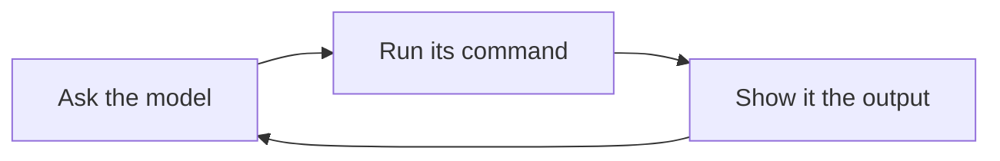

# How it works

Keel is a loop with four steps.



1. **Ask.** Send the task and the conversation so far to the model.
2. **Act.** The model replies with its reasoning and one bash command in a fenced code block. Keel runs it.
3. **Observe.** The command's exit code and output go back to the model.
4. **Repeat** until the model says it is finished.

## The command format

Keel asks the model to write each command as a fenced `bash` block:

````
I need to see what is in this folder first.

```bash
ls -la
```
````

Keel pulls the command out of the block and runs it with `bash -c`. Plain text works the same way on every model and server, so you don't need to know which ones support tool calling.

Every command runs in a fresh shell, so a `cd` or an exported variable doesn't carry over to the next command. The model is told to write commands like `cd /path && ...` when it needs to.

## What the model sees

After each command, the model gets the exit code followed by the command's output, with both stdout and stderr included:

```
exit=0
total 8
drwxr-xr-x  2 user  staff  64 Nov 20 09:00 .
```

Output longer than 10,000 characters is cut down to the final 10,000, so one noisy command can't flood the conversation.

## Finishing a task

The model ends the run by running a command that prints `COMPLETE_TASK_AND_SUBMIT_FINAL_OUTPUT` as its first line and exits successfully:

```bash
echo COMPLETE_TASK_AND_SUBMIT_FINAL_OUTPUT
```

Whatever the command prints after that line becomes the final answer. If nothing follows it, Keel returns the text of the model's last reply.

## Limits

| Limit | Value |
|---|---|
| Steps per task | 50 |
| Consecutive replies without a command | 3 |
| Time per command | 120 seconds |
| Output kept per command | last 10,000 characters |

When a reply has no command, Keel drops it from the conversation and reminds the model of the format. After three such replies in a row, the run stops.
