# Results

Every change to the harness gets a score. This page is the scoreboard: one bar per run, grouped by benchmark, so you can watch the success rate move as Keel gains new abilities.



## Scoreboard

--8<-- "runs/scoreboard.md"

Each cell is tasks passed out of tasks attempted. Every run uses the same 10 hand-picked tasks per benchmark (the lists are in `bench/subsets/`), so a bar going up means the harness got better, not that the questions got easier.

## How a run is scored

- **Pass means the official tests passed.** Terminal-Bench and Aider Polyglot run each task's own tests in its container. SWE-bench Lite is graded by the SWE-bench harness.
- **Errors count as failures.** If a task can't start or can't be graded, it scores zero, because the harness is what has to cope with it.
- **Same tasks every time.** The task lists are fixed, so runs are comparable. Growing a list starts a new series.
- **Everything is recorded.** Each run lives in `runs/<run>/` with a `manifest.json` holding the commit, the hash of `agent.ts`, the machine and the exact tasks, next to every trial's logs.

## Add a run to the scoreboard

```bash
HARNESS=edit-tool MODELS=ollama/qwen3-coder:30b bench/baseline.sh
python bench/summarize.py
```

`bench/summarize.py` reads every folder under `runs/` and rewrites `runs/results.json` (every task's outcome), `runs/scoreboard.md` and the chart above. Commit them with the run, and the docs site picks them up on the next build.

## Models and harness changes

Every run records two separate labels in its manifest: the **harness** (`baseline`, `edit-tool`, and so on) and the **model**. That keeps the two questions apart, and a leaderboard can sort or filter by either:

| Question | Hold fixed | Change | Example |
|---|---|---|---|
| Which model is best in this harness? | Harness | Model | `HARNESS=baseline`, a different model |
| Which harness change helps? | Model | Harness | the same model, `HARNESS=edit-tool` |

The folder name combines them, `runs/<model>/` for the baseline and `runs/<model>-<harness>/` after that.

The list of changes to try, and what each one is expected to do, is on the [Harness changes](harness-changes.md) page.
